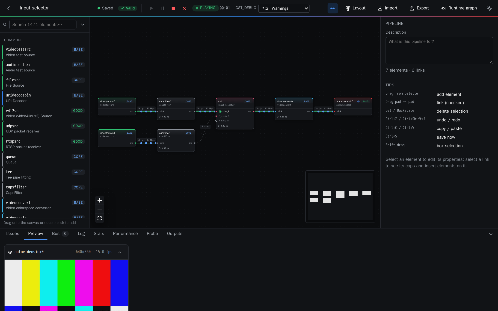

# Pipelab

Prototype GStreamer pipelines visually, run them with live previews and diagnostics, and export
the result as code for your application.



- **Every element of the machine.** GStreamer 1.28 with core, base, good, bad, ugly, libav, the
  Rust plugins, VA-API, QSV and NVIDIA `nvcodec` (NVDEC/NVENC and the CUDA filters), introspected
  live: around 1,500 elements, with every property typed and editable.
- **Links checked before they exist.** Caps are propagated through the graph. Incompatible
  links are refused with the elements that would bridge them, and the validator flags missing
  queues, parsers and converters, preroll deadlocks and invalid properties, with one-click
  fixes.
- **Run and inspect.**
  - Play, pause and stop; browser previews for video and audio sinks.
  - Bus messages that point at the failing element, with hints.
  - Live property changes, and input-selector switching on the node itself.
  - Watch or probe any link; the real runtime graph.
- **Performance.** Time per buffer in each element, queue fill levels and streaming threads
  with their CPU. Links can be coloured by thread, and bottlenecks are flagged.
- **Components.** Group elements into reusable blocks with ports and parameters, start from a
  starter library (RTSP inputs, encoders, recorders, network outputs), and share them as files.
- **Export.** gst-launch-1.0, Python (PyGObject), C, Rust (gstreamer-rs) or JSON. The Python and
  Rust exports are small libraries: one builder per component and a type that owns the
  pipeline.
- **Live monitor.** Reconstruct, read-only, the pipeline running inside another process on the
  machine — a command-line `gst-launch`, or an app in C, Rust or Python, even in another
  container — and watch it flow, with the same throughput, latency and thread statistics as the
  design mode.

## Live monitor

The **Live monitor** (top of the pipelines page) lists the GStreamer processes on the machine and
reconstructs the pipeline of the one you pick, read-only. It never modifies the observed pipeline.

**Structure** (always) is obtained in one of two ways:

- **No code change (dot-dir):** start the target with `GST_DEBUG_DUMP_DOT_DIR` set, and Pipelab
  reads the graph GStreamer dumps there — this works for pipelines started from the command line or
  from C, Rust or Python, and reaches dumps inside other containers.
- **No restart (gdb):** Pipelab attaches with gdb and asks the live process to serialise its
  pipelines. This needs no environment variable but needs permission to ptrace the target.

**Live statistics** — buffers/sec, bitrate, per-element and end-to-end latency, and the streaming
threads, flowing on the graph like the design mode — need the pipeline to have been **launched with
the GStreamer tracers** (they cannot be turned on after it starts). Launch your process with:

```bash
GST_TRACERS="stats;latency(flags=pipeline+element)" \
GST_DEBUG=GST_TRACER:7 \
GST_DEBUG_FILE=/path/pipelab-can-read.log \
GST_DEBUG_DUMP_DOT_DIR=/path/dots \
  your-application            # or gst-launch-1.0 …
```

Pipelab tails that log (through `/proc/<pid>/root`, so logs inside other containers work) and shows
the statistics live. Without the tracers you still get structure, element states and caps, and the
monitor tells you how to enable the rest. Previews of the media are not shown — that would require
tapping the pipeline, which the monitor never does.

By default the API only sees processes in its own container. To monitor the whole host, run it with
the host PID namespace:

```bash
make up MONITOR=1
```

This is an **elevated, opt-in stack**: reading an unconfined host process's `/proc` from a container
requires the API to run as root with `CAP_SYS_PTRACE` and with the AppArmor/seccomp confinement
lifted (`docker-compose.monitor.yml`). Enable it only where that is acceptable; the normal stack
stays unprivileged and non-root. To keep production untouched, run the monitor as a separate stack:

```bash
mkdir -p .monitor-data   # pre-create so Docker doesn't make it root-owned
PIPELAB_PORT=8082 PIPELAB_DATA=./.monitor-data \
  docker compose -p pipelab-monitor -f docker-compose.yml -f docker-compose.monitor.yml up -d
```

## Quick start

Requirements: Docker with Compose v2. For NVIDIA elements, you also need the NVIDIA driver and the
NVIDIA Container Toolkit.

```bash
make up          # build and start on http://localhost:8080
make up GPU=1    # the same, with NVIDIA GPU access
make logs        # follow the logs
make down        # stop
```

Your projects, components, media files and the element catalog cache live in `./data`, on your
machine only (it is git-ignored). Relative file names in pipelines resolve inside `data/media`.
To receive RTP, RTSP or SRT streams from other machines, publish the ports in
`docker-compose.devices.yml` and start with `make up DEVICES=1`.

## Documentation

- [User manual](docs/manual/README.md): the interface, step by step, with screenshots.
- [Architecture](docs/ARCHITECTURE.md): modules, data model, HTTP API and runtime protocol.
- [Development](docs/DEVELOPMENT.md): running the tests, the dev mode and how to extend
  Pipelab.

The HTTP API is also described by OpenAPI at `http://localhost:8080/api/docs`.

## Known limitations

- There is no display or sound card inside Docker, so display and audio sinks are previewed in
  the browser. You can turn this off per sink.
- Object-typed properties (for example `playbin.video-sink`) cannot be set as text, just as in
  `gst-launch-1.0`.
- Properties without a mutability flag can be *tried* while playing. If the element ignores the
  change, the value read back shows it.
- NVIDIA elements depend on the GPU: an element appears only if the card supports it, for
  example AV1 needs an RTX 30 series or newer.
- The live monitor's gdb method matches plain `GstPipeline` / `gst-launch` pipelines; a pipeline
  that is an instance of a custom `GstPipeline` subclass is reconstructed only through the dot-dir
  method. The monitor is read-only; it never changes the observed pipeline.
