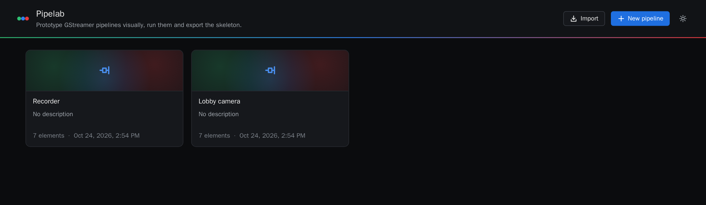
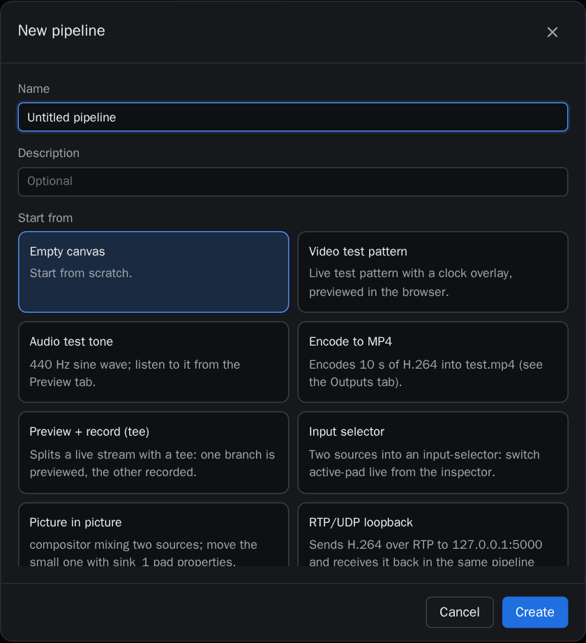
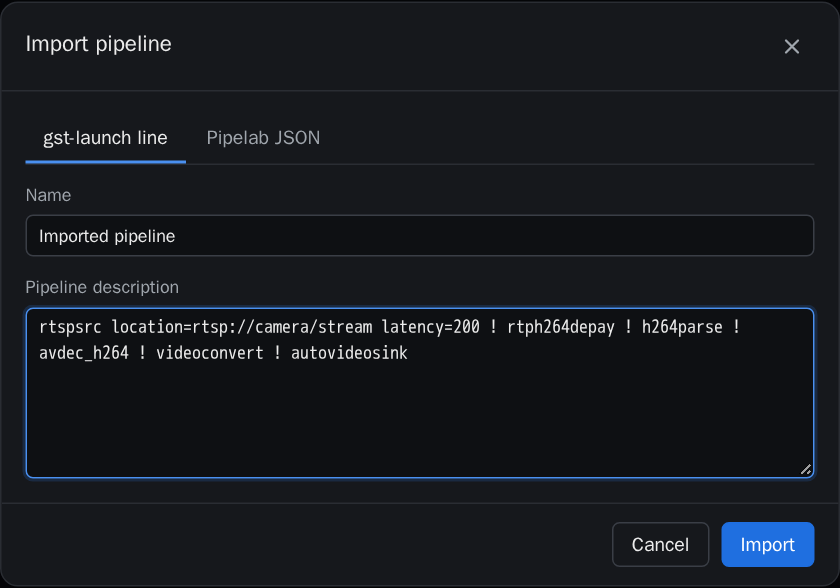

# 1. Getting started

## Start Pipelab

Everything runs in Docker. From the repository folder:

```bash
make up          # build and start on http://localhost:8080
make up GPU=1    # the same, with access to the NVIDIA GPU
make down        # stop
```

The first start inspects every installed GStreamer element (around 1,500) and caches the result
in `data/cache`, which takes a few seconds. Your work is stored in `data/`, on your machine only:
it is not part of the repository.

## Projects

The home page lists your pipelines. Each one is a project: a graph of elements saved
automatically while you edit.



- **New pipeline** creates a project, empty or from a template.
- **Import** creates a project from a `gst-launch-1.0` line or a Pipelab JSON file.
- The sun/moon button switches between the dark and light themes.

## Templates

Templates are small, idiomatic pipelines to start from: test patterns, MP4 recording, a tee with
preview and recording, an input-selector, picture-in-picture, an RTP loopback, file playback,
HLS output, audio analysis and NVIDIA encode/decode. Templates that need elements missing on
your machine (for example NVIDIA ones without a GPU) say so.



## Import a gst-launch line

Paste a `gst-launch-1.0` description, as you would type it in a terminal (with or without the
`gst-launch-1.0` prefix). Named elements (`name=t`) and references (`t.`) are supported, and
property values are typed using the element's real properties. The graph is laid out
automatically.



Relative file names (`location=video.mp4`) are resolved inside `data/media`.
