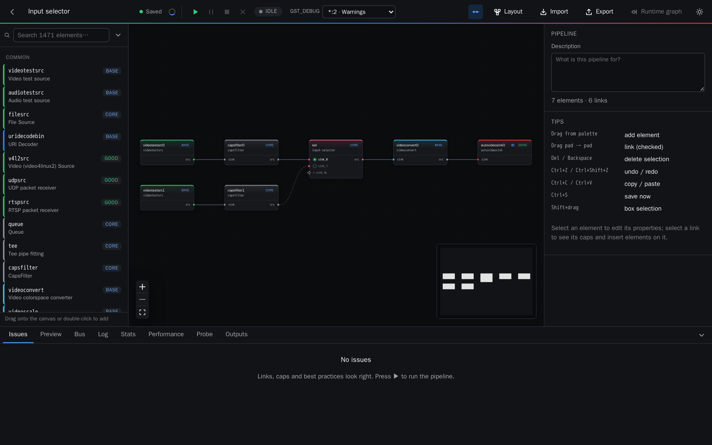
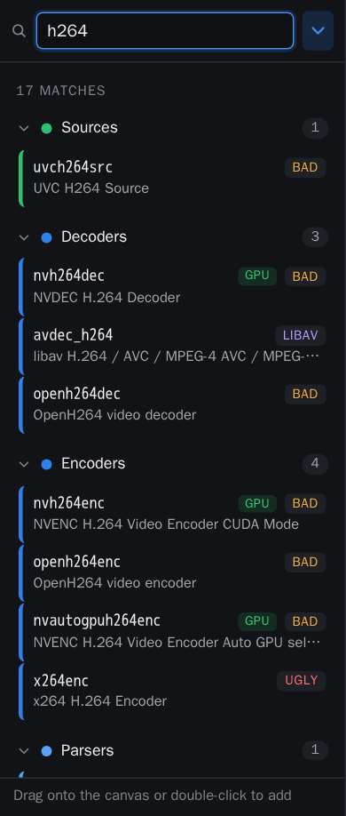
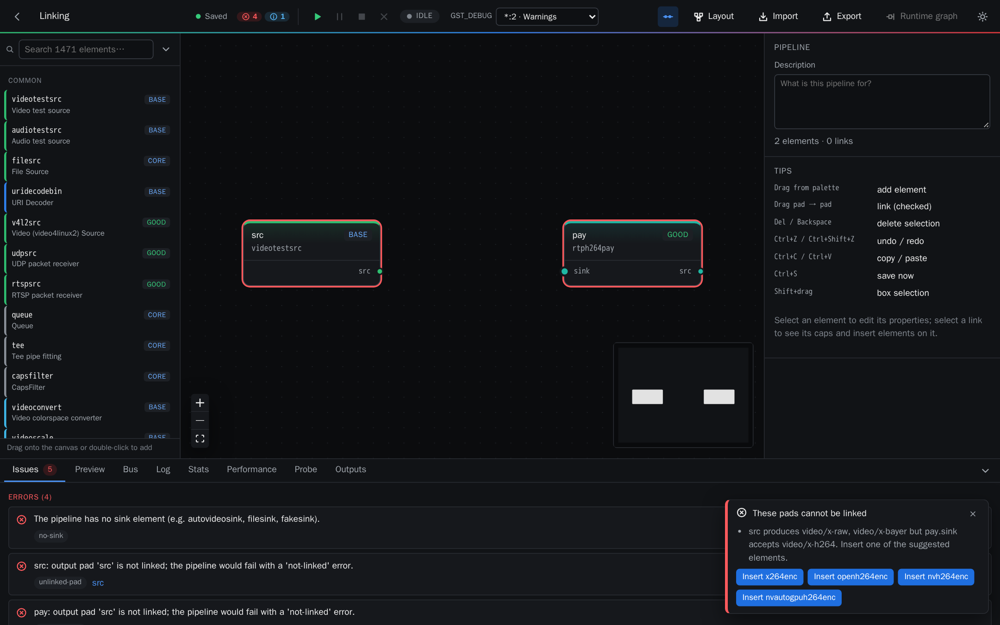
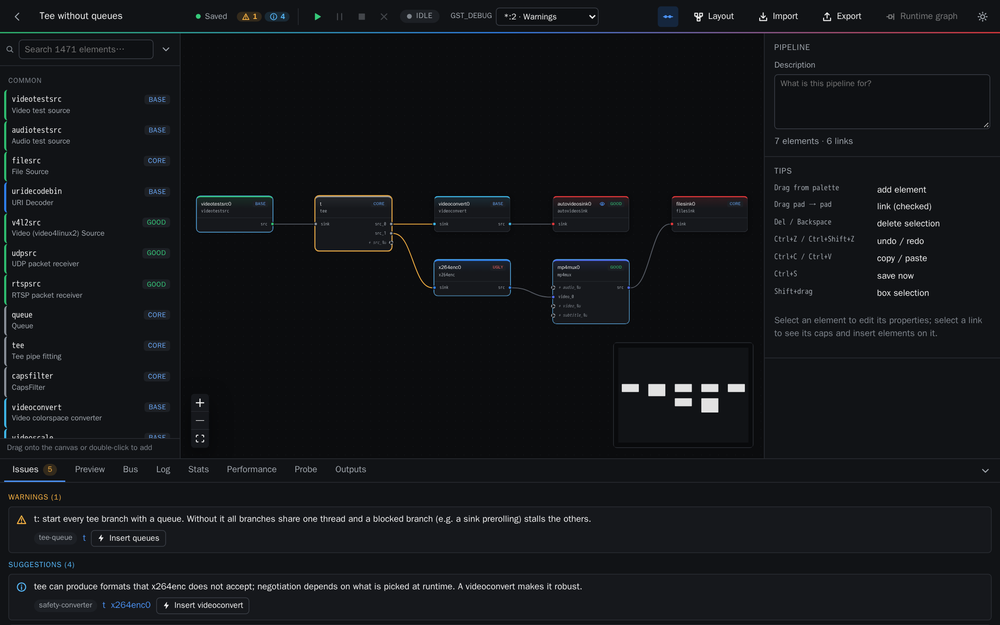
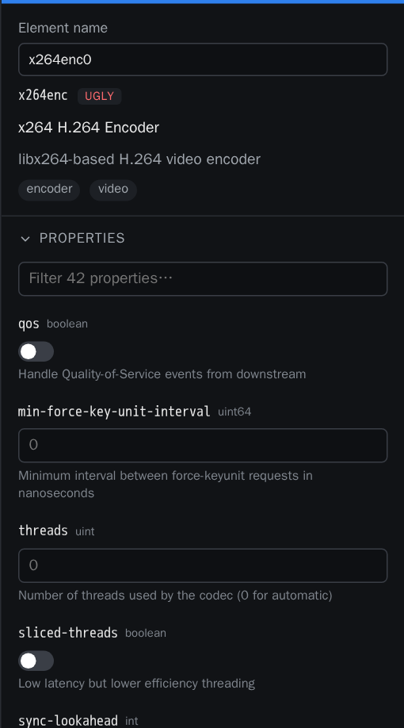

# 2. Building pipelines

The editor has five areas:

- **Palette** (left): every GStreamer element of the machine, plus your components.
- **Canvas** (centre): elements and the links between their pads.
- **Inspector** (right): properties of the selected element or link.
- **Dock** (bottom): issues, previews, bus messages, logs, statistics, performance, probes and
  produced files.
- **Top bar**: project name, save and validation state, run controls, layout, import, export and
  the runtime graph.

## Adding elements

The palette shows the most common elements first, then every element grouped by category
(sources, sinks, decoders, encoders, parsers, muxers, payloaders…). Search by name, description
or plugin; the filter button narrows by category and by family (core, base, good, bad, ugly,
libav, rust, GPU…).

Drag an element onto the canvas, or double-click it to add it next to the selection.

| Shortcut | Action |
| --- | --- |
| Drag a pad onto another pad | link (checked first) |
| Del / Backspace | delete the selection |
| Ctrl+Z / Ctrl+Shift+Z | undo / redo |
| Ctrl+C / Ctrl+V | copy / paste |
| Ctrl+S | save now |
| Shift+drag | box selection |

**Layout** arranges the graph from left to right.

## Linking and validation

Every link is checked against the caps of both pads *before* it is created, taking into account
what flows through the pipeline up to that point (a capsfilter, an encoder, a demuxer…).
Incompatible links are refused, and Pipelab suggests the elements that would make them work.
One click inserts them.

Request pads (`tee.src_%u`, `compositor.sink_%u`…) are requested automatically. Sometimes pads
(`decodebin`, `rtspsrc`, demuxers) are linked when they appear at runtime.

## Issues and fixes

The **Issues** tab lists what is wrong or risky in the whole graph, as errors, warnings and
suggestions. Examples:

- unlinked pads, or a pipeline without a source or a sink;
- incompatible caps;
- a `tee` or demuxer branch without a `queue`, which deadlocks or stalls;
- missing parsers, or a converter recommended for robustness;
- a live source feeding a sink that also prerolls;
- properties with invalid values.

Most issues come with a fix button. Selecting an issue highlights the elements involved.

## Properties

Select an element to edit all of its properties, typed from GStreamer itself: numbers with
their ranges, enums and flags as lists, caps, booleans and strings. Properties of request pads
(for example a compositor input's `xpos`) appear under the pad.

Selecting a link shows its negotiated caps (once the pipeline has run), the template caps of
both pads, and quick buttons to insert a `queue`, a converter or any element on it.
