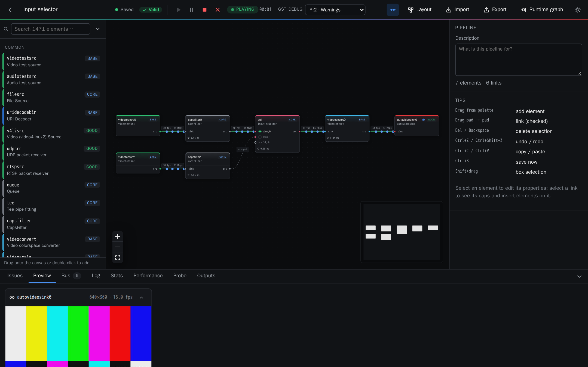
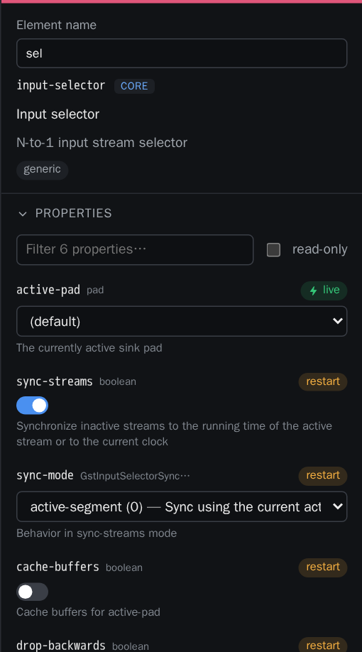
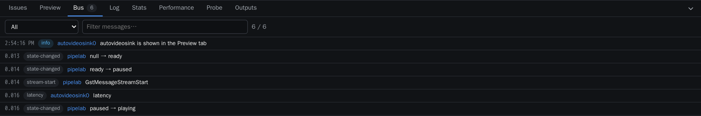
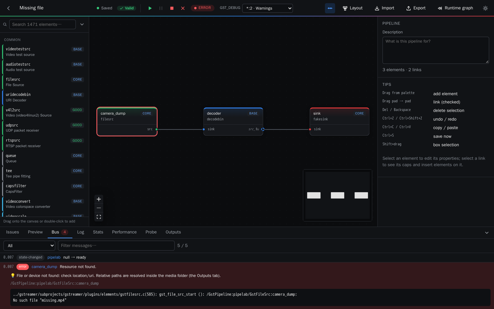
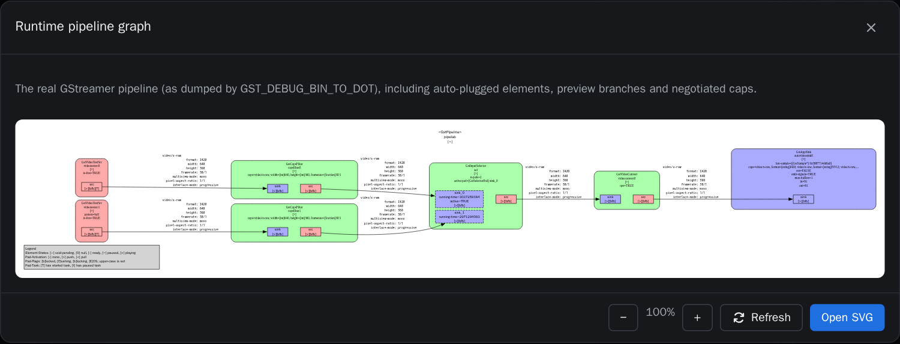
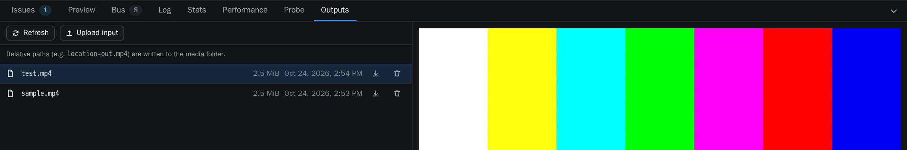

# 3. Running pipelines

Each pipeline runs in its own process on the server, so a crash in an element cannot take
Pipelab down.

## Run controls

In the top bar:

- **Play** starts the pipeline from the current graph, including unsaved changes.
- **Pause** pauses it.
- **Stop** sends end-of-stream first, so files are finalised, then stops.
- **Kill** stops immediately.
- **GST_DEBUG** sets the debug level used when the pipeline starts. Its output goes to the
  **Log** tab.

While the pipeline runs, links show their frame rate and bitrate, and dots travel along them at
the rate of the buffers.

If you change the graph while it runs, a **Restart** button applies the new structure.

## Previews

Display sinks (`autovideosink`, `xvimagesink`, `glimagesink`…) are replaced automatically by a
preview in the browser, and audio sinks by an audio player with a level meter. Find them in the
**Preview** tab. The replacement accepts whatever the pipeline negotiates, so it does not change
how the rest of the pipeline behaves. To disable it for one sink, use the switch in that sink's
inspector.

## Changing properties live

Properties that GStreamer allows to change while playing can be edited in the inspector during
the run. The value shown is the one really in effect, read back from the element. For
`input-selector` and `output-selector`, the active pad can also be chosen directly on the node:
links that are not active are drawn as *dropped*.

## Bus messages

The **Bus** tab lists the pipeline's messages: errors, warnings, state changes, end-of-stream,
QoS, tags, latency, buffering and element messages. Each message says which element posted
it. Errors highlight that element on the canvas and come with a hint when the cause is common
(missing file, unreachable host, not-negotiated caps, busy device…).

When caps negotiation fails, Pipelab identifies the link and the caps field that does not match.

## Runtime graph

**Runtime graph** shows the real pipeline as GStreamer built it: the elements created inside
bins (`decodebin`, `rtspsrc`, components…) and the caps negotiated on every pad.

## Produced files

The **Outputs** tab lists the files written by the pipeline (`filesink`, `splitmuxsink`,
`multifilesink`, `hlssink2`…) and plays them in the browser: video, audio, images and HLS
playlists. You can also upload input files there. They are stored in `data/media`.

