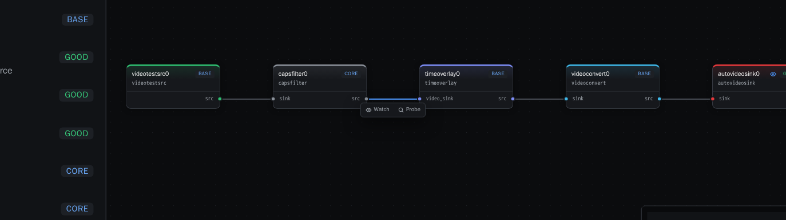
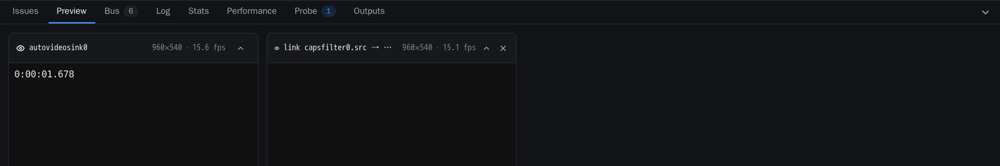
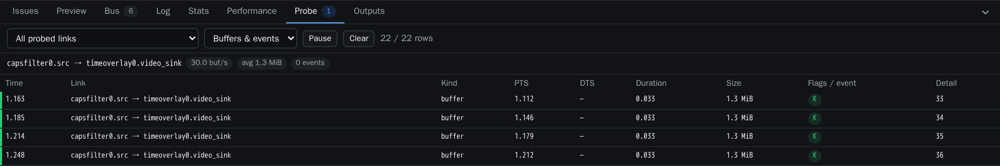
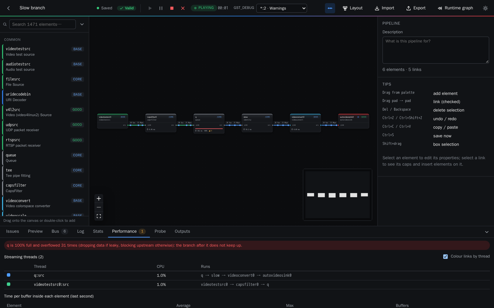

# 4. Inspecting a running pipeline

## Watch and probe a link

Hover over or select a link while the pipeline runs to get its toolbar.

- **Watch** shows what flows through the link in the **Preview** tab. Raw and encoded video are
  decoded on the side and shown as frames, and audio can be listened to. Your pipeline is not
  modified.

  

- **Probe** lists every buffer and event crossing the link in the **Probe** tab, like a small
  Wireshark:
  - buffers with PTS, DTS, duration, size and flags (key unit or delta, discont…);
  - events: caps, segment, tags, flush, EOS…

  A summary shows the buffer rate. Pause the list to read it, or filter by link and by kind.

  

## Statistics

The **Stats** tab gives, for every link, the negotiated caps, buffers, rate, bitrate and bytes,
along with the playback position.

## Performance

The **Performance** tab, together with the badges on the nodes, shows where the time goes:

- **Time per buffer inside each element**: Pipelab matches the timestamp of a buffer entering
  and leaving the element, and shows the average and maximum over the last second. The node
  shows it with ⏱. For a `queue` this is the waiting time. Encoders and decoders hold several
  frames on purpose, so a high value there is latency, not necessarily a bottleneck.
- **Queues**: every `queue` and `queue2` shows how full it is, as a bar on the node, along with
  how many times it overran (it was full and blocked upstream, or dropped data if leaky) and
  ran dry.
- **Streaming threads**: each thread with its CPU usage and the elements it runs.
  **Colour links by thread** draws every link in the colour of its thread, so you can see where
  one thread ends and where a `queue` would split it.
- **Bottlenecks**: a queue that is full means the branch after it does not keep up. A thread
  close to 100 % of a core should be split with a queue. Click a warning to select the element.

