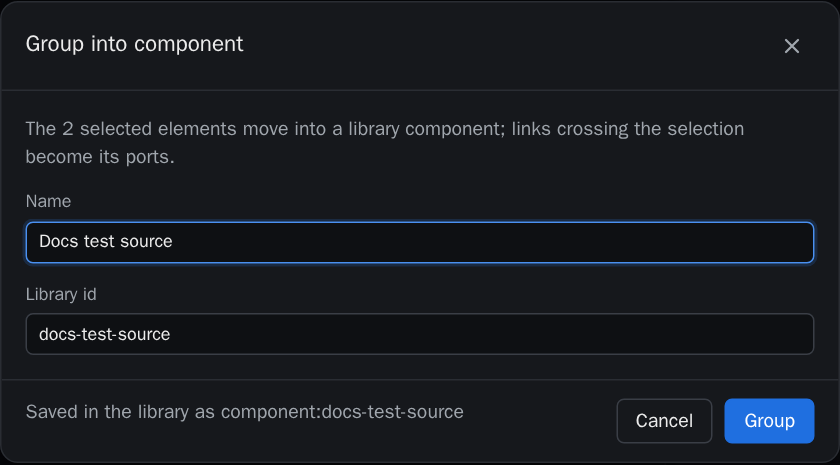
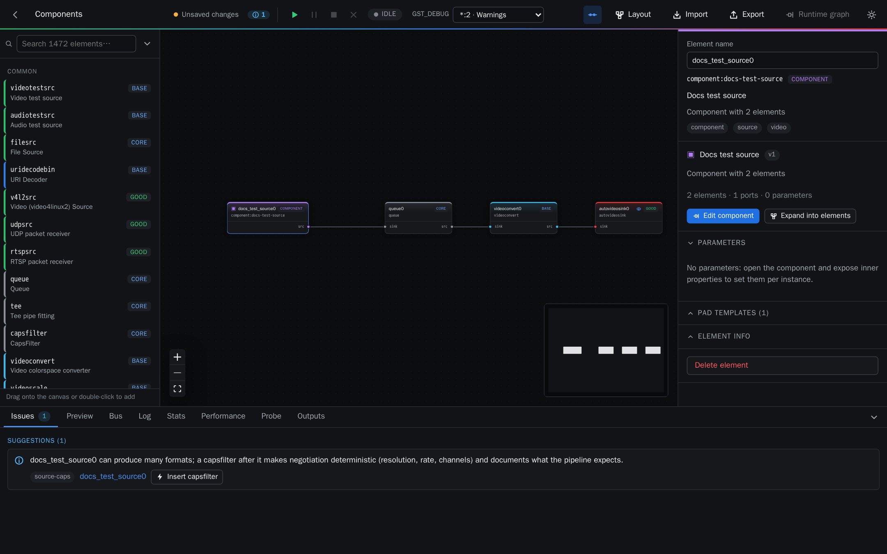
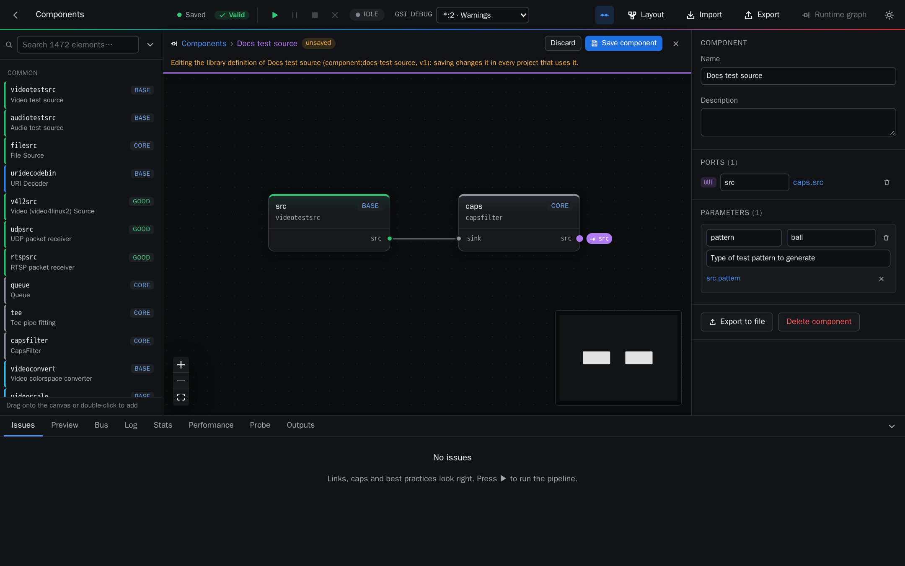
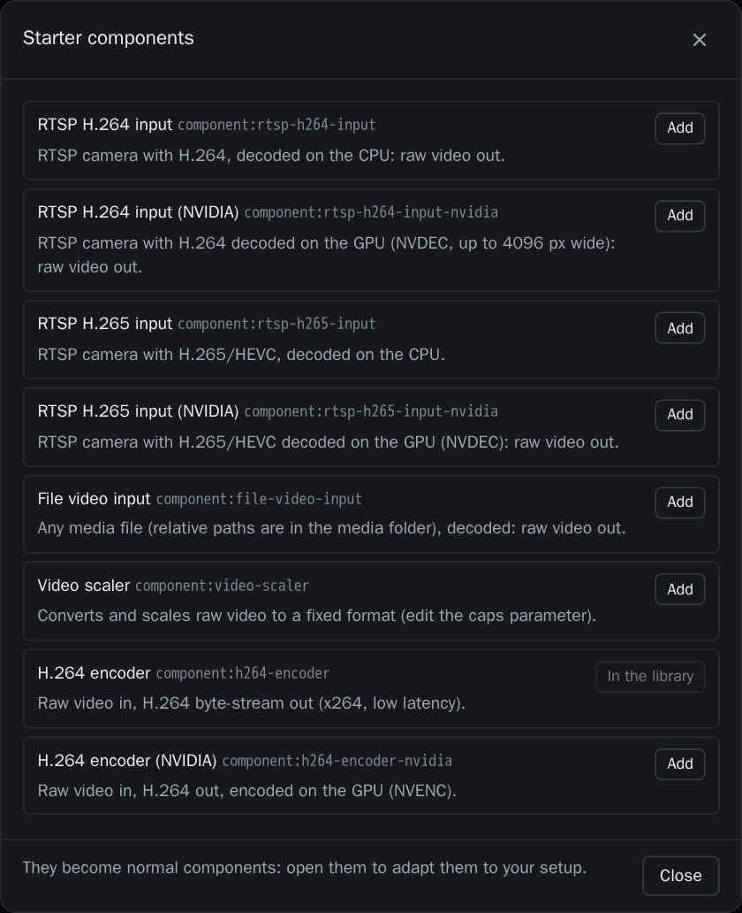

# 5. Components

A component is a reusable block made of several elements, for example an RTSP input:
`rtspsrc → depay → parse → decoder → videoconvert`, raw video out. Components live in a library
shared by all your projects. They appear in the palette, and they validate, run and export like
any element.

## Create a component from a selection

Select the elements (Shift+click or Shift+drag) and press **Group into component** in the
inspector. Give it a name; the library id is derived from it.

The elements are replaced by one instance of the new component. Links that crossed the
selection become the component's **ports**.

You can also start from an empty component with **New component** in the palette.

## Edit a component

Double-click an instance to open its definition. The breadcrumbs at the top say where you are;
click the project name, or ✕, to go back. Inside, you can:

- edit the elements and links like a normal pipeline;
- expose an inner pad as a **port**: select an element and use **Expose as port**;
- expose an inner property as a **parameter**: use the export button of a property row. One
  parameter can drive several inner properties, and it can have a default and a description.

**Save component** stores the new version in the library and updates every project that uses
it. **Discard** throws the changes away. The Issues tab checks the definition itself: ports
must refer to real pads, and parameters to real properties.

## Use components

Instances are linked to the library: editing the component changes all of them. Each instance
has its own parameter values in the inspector. **Expand into elements** replaces an instance with a copy of
its elements, independent from the library.

At runtime and in exported code, each instance is a `GstBin` with ghost pads. Errors and
statistics of inner elements are reported as `instance/element`.

## Starter components

**Starters…** in the palette lists ready-made components to add to your library and adapt:

- RTSP inputs for H.264 and H.265, decoded on the CPU or on the GPU;
- a file input and a video scaler;
- H.264 encoders (x264 and NVENC);
- an MP4 recorder that writes segments;
- SRT, RTMP and RTP/UDP outputs;
- a display that never slows its branch down.

Starters whose elements are not available on the machine say so.

## Share components as files

Open a component and press **Export to file** to download `<id>.pipelab-component.json`. The
file includes any components it contains. **Import…** in the palette adds such a file to
another library, and asks before replacing components that already exist.

**Delete component** first tells you which projects and components use it.
