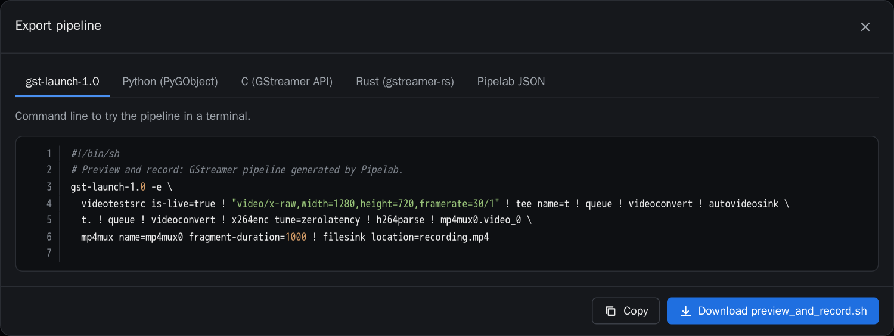
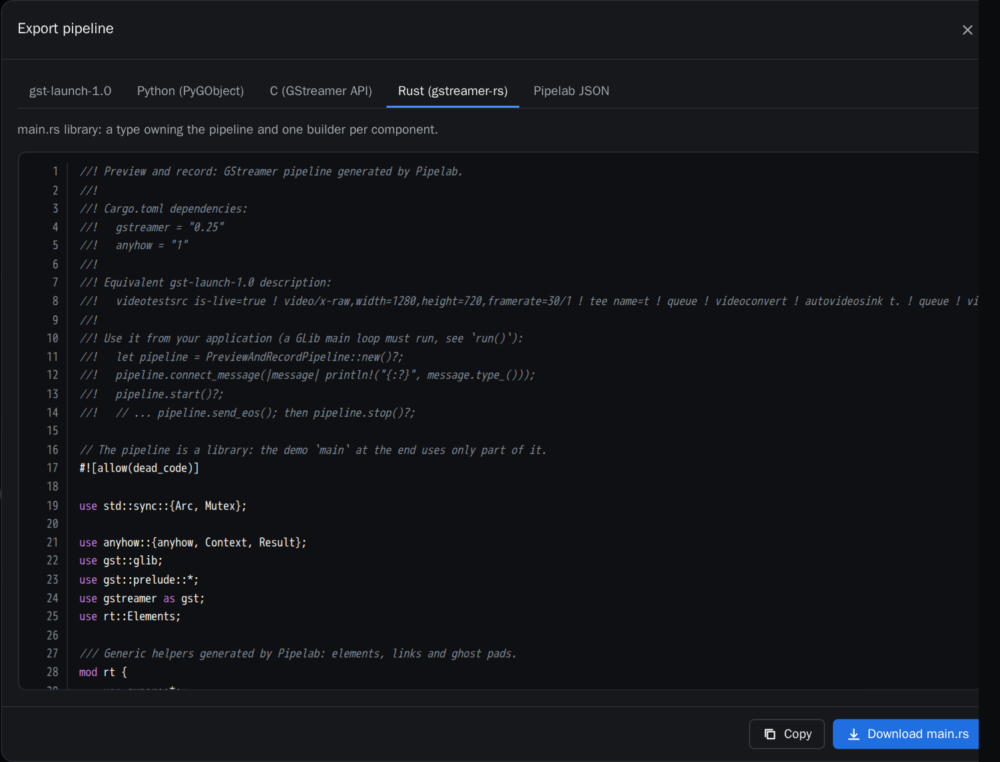

# 6. Exporting

**Export** in the top bar turns the pipeline into something you can integrate into a product.
Copy the text or download the file.

| Format | What you get |
| --- | --- |
| gst-launch-1.0 | A shell script to try the pipeline in a terminal. Components are expanded into plain elements. |
| Python (PyGObject) | A module with one builder per component and a class that owns the pipeline. |
| C (GStreamer API) | A single-file program with bus handling and dynamic pad linking (`gcc main.c $(pkg-config --cflags --libs gstreamer-1.0)`). |
| Rust (gstreamer-rs) | A `main.rs` library with the same structure as the Python one. |
| Pipelab JSON | The graph, to import it back into Pipelab. |



## Python

```python
pipeline = PreviewAndRecordPipeline()
pipeline.on_message(lambda message: print(message.type))  # every bus message
pipeline.start()          # needs a running GLib main loop (or call run())
...
pipeline.send_eos()       # finish files cleanly, then
pipeline.stop()
```

- `build_<component>(name, *, param=None, ...) -> Gst.Bin` creates one instance of a component.
  Call it as many times as you need, for example one per camera.
- `element("name")` returns an element; use `"instance/inner"` for elements inside a component.
- `run()` plays until end-of-stream or error. Ctrl+C sends EOS first.

## Rust



```rust
let pipeline = PreviewAndRecordPipeline::new()?;
pipeline.connect_message(|message| println!("{:?}", message.type_()));
pipeline.start()?;
// ...
pipeline.send_eos();
pipeline.stop()?;
```

- `build_<component>(name, &<Component>Params) -> Result<gst::Bin>` creates one component
  instance. Fields left as `None` keep their defaults.
- The required crates (`gstreamer`, `anyhow`) are listed at the top of the file.

The tests check that every export really works: the gst-launch output parses, the Python code
runs to end-of-stream, the C code compiles and the Rust code builds with cargo and runs.
