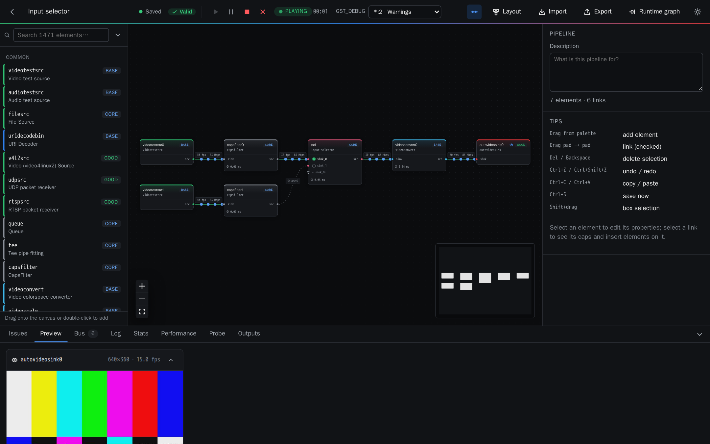

# Pipelab user manual

Pipelab is a web tool to design GStreamer pipelines on a canvas, check that every link is valid
before running them, run them with live previews and diagnostics, and export the result as code
for your application.

1. [Getting started](01-getting-started.md) — start Pipelab, projects, templates, importing a
   `gst-launch-1.0` line.
2. [Building pipelines](02-building-pipelines.md) — palette, linking, validation and one-click
   fixes, element properties.
3. [Running pipelines](03-running.md) — play/pause/stop, previews, bus messages, live property
   changes, runtime errors, produced files.
4. [Inspecting a running pipeline](04-inspecting.md) — watching and probing links, statistics,
   performance (latency, queues, streaming threads).
5. [Components](05-components.md) — reusable macro blocks, starter components, sharing them as
   files.
6. [Exporting](06-exporting.md) — gst-launch, Python, C, Rust and JSON.
7. [GPU and troubleshooting](07-gpu-and-troubleshooting.md) — NVIDIA elements and common
   problems.

The screenshots are generated from the real interface with `make docs GPU=1` (see
[DEVELOPMENT.md](../DEVELOPMENT.md)).
